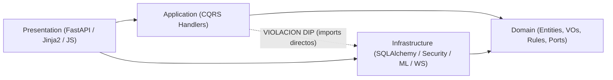

# Sprint 0 · Diagnóstico Integral de Arquitectura, ERS, UI/UX, IA y Seguridad — CASAGBI

> **Alcance del documento:** Auditoría técnica de **solo lectura** previa al inicio de los Sprints 1 a 5. Toda evidencia citada corresponde a archivos, líneas y ejecuciones reproducidas directamente sobre la línea base actual del repositorio.

---

## 1. Mapa Real del Repositorio y Dependencias entre Capas

### 1.1 Árbol Real del Proyecto

```text
MesaDeServiciosMVP/
├── data/
│   ├── mesa_servicios_upc.db                 # SQLite en modo WAL + triggers append-only
│   ├── raw/upc_tickets_raw.csv               # Dataset sintético crudo (18,000 registros)
│   └── processed/
│       ├── upc_tickets_clean.csv             # Base limpia CRISP-DM (17,658 registros)
│       └── upc_tickets_excluded.csv          # Anomalías documentadas (342 registros)
├── docs/
│   ├── PROGRESO.md                           # Registro vivo de avance, decisiones y riesgos
│   └── solicitudes-de-cambio-ERS.md          # SCR-01 a SCR-05 frente a la ERS oficial
├── models/
│   ├── keyword_baseline.joblib               # Baseline determinístico por palabras clave
│   ├── multinomial_nb.joblib                 # Modelo activo actual (Naive Bayes alpha=0.5)
│   ├── logistic_regression.joblib            # Candidato lineal balanceado (TF-IDF 1-2, C=2.0)
│   ├── linear_svc.joblib                     # Candidato LinearSVC calibrado (Platt Scaling)
│   ├── urgency_classifier.joblib             # Clasificador auxiliar de urgencia por texto
│   └── model_registry.json                   # Registro y métricas 5-Fold CV / Hold-out 80-20
├── notebooks/01_eda_and_crispdm.ipynb        # Cuaderno reproducible CRISP-DM ejecutado
├── src/
│   ├── main.py                               # Entrypoint FastAPI (lifespan, middlewares, Jinja2)
│   ├── bootstrap.py                          # Bootstrap idempotente (dataset -> ML -> SQLite)
│   ├── cleaning.py / metrics.py              # Re-export limpieza CRISP-DM y métricas ITIL/ML
│   ├── domain/                               # CAPA 1: Dominio puro
│   │   ├── entities/__init__.py              # User, RefreshToken, Ticket, TicketMessage, TicketAuditEvent, KnowledgeArticle, AuditLog, Notification
│   │   ├── value_objects/__init__.py         # TicketCode (MS-AAAA-NNNNNN), PriorityMatrix, SLADeadline
│   │   ├── exceptions/__init__.py            # Jerarquía DomainError mapeable a RFC 7807
│   │   ├── ports/__init__.py                 # IUnitOfWork, I*Repo, IAIService
│   │   ├── repositories.py                   # Alias retrocompatibles hacia ports/
│   │   └── rules.py                          # Constantes UPC, matriz OR-03, horas hábiles OR-04, SLA, RBAC
│   ├── application/                          # CAPA 2: Aplicación CQRS
│   │   ├── common/__init__.py                # Command, Query, Result, sanitize_user_dict
│   │   ├── auth/__init__.py                  # Login (c/ DEMO_MODE), Register, Refresh, Logout, GetMe
│   │   ├── tickets/__init__.py               # Create, Transition, Reassign, Chat, Rate, List, Detail, Public
│   │   ├── analytics/__init__.py             # KPIs, Comparativa ML, Train, Activate, AuditLogs, KB
│   │   └── ai_agent/__init__.py              # ProcessAgentTurnCommand, ConfirmAgentDraftCommand
│   ├── infrastructure/                       # CAPA 3: Infraestructura
│   │   ├── composition.py                    # Fábricas UoW y singleton LocalNLPEngine
│   │   ├── persistence/                      # database.py, orm_models.py, repositories.py, unit_of_work.py, seeder.py
│   │   ├── security/                         # jwt_provider.py, password_hasher.py
│   │   ├── ml/                               # dataset_generator.py, cleaning_pipeline.py, model_trainer.py, ai_engine.py
│   │   └── realtime/ws_connection_manager.py # Gestor salas WebSocket en memoria por ticket_id
│   └── presentation/                         # CAPA 4: Presentación
│       ├── api/dependencies/auth_guards.py   # get_current_user, get_optional_user, require_roles
│       ├── api/middlewares/                  # problem_details_handler.py (RFC 7807), request_audit_middleware.py
│       ├── api/v1/                           # auth_router, tickets_router, ai_agent_router, analytics_router, ws_router
│       └── web/                              # templates/*.html (Tailwind v4) + static/{css,js}
└── tests/
    ├── test_domain_rules.py
    ├── test_ai_pipeline.py
    └── test_fastapi_architecture.py
```

### 1.2 Flujo Real de Dependencias y Violaciones de Clean Architecture



Aunque `src/domain/` y `src/application/` respetan la prohibición de no importar `fastapi`, `sqlalchemy` ni `starlette` (validado por `test_clean_architecture_dependency_boundaries`), se detectaron **4 violaciones concretas de la regla de dependencia interna / separación de capas**:

1. **`src/application/auth/__init__.py` (líneas 23–30):** importa directamente funciones concretas de infraestructura (`ACCESS_TOKEN_EXPIRE_MINUTES`, `create_access_token`, `generate_refresh_token`, `hash_password`, `hash_refresh_token`, `verify_password`) desde `src.infrastructure.security` en vez de recibir puertos abstractos (`IPasswordHasher`, `ITokenProvider`) definidos en `src/domain/ports/`.
2. **`src/application/analytics/__init__.py` (líneas 14–23):** importa directamente implementaciones concretas de `src.infrastructure.ml` (`LocalNLPEngine`, `clean_tickets_dataset`, `generate_synthetic_dataset`, `load_model_registry`, `set_active_model`, `train_and_evaluate_models`). Debería depender de un puerto `IMLTrainerPort` / `IAIService` inyectado desde infraestructura.
3. **`src/application/ai_agent/__init__.py` (líneas 24–29):** importa directamente `LocalNLPEngine`, `TICKET_ID_REGEX`, `extract_campus_entities` y `strip_accents_lower` desde `src.infrastructure.ml.ai_engine`.
4. **Arquitectura Frontend monolítica (`src/presentation/web/static/js/features/admin_dashboard.js`, 813 líneas):** concentra en un solo archivo el enrutamiento de pestañas, filtros, construcción de DOM, llamadas `fetch`, estado de gráficos Chart.js y lifecycle WebSocket, sin separación *smart* (`*_container.js` con `mount()`/`destroy()`) vs *dumb* (`*_view.js`), ni `AbortController` para cancelar solicitudes pendientes al cambiar de vista.

---

## 2. Brechas frente a la ERS (`RF`, `RNF`, `RIU`, `RIC`, `OR`) y los Sprints 1–5

| Código ERS | Estado | Brecha detectada en el código actual | Sprint objetivo |
|---|---|---|---|
| **RF-01 / RNF-07 / RIU-01** | Parcial | Se implementó JWT + Refresh rotativo (documentado como decisión MVP en `SCR-05`) y se protegió `DEMO_MODE`; falta expiración automática por **30 minutos de inactividad** en cliente/servidor. | Sprint 2 / 3 |
| **RF-02 / CU-14** | Parcial | `IUserRepo.list_users` y `update` existen en infraestructura, pero faltan endpoints REST y pantalla para gestionar usuarios, roles, áreas y activar/inactivar verificando no desactivar al último admin activo. | Sprint 4 |
| **RF-04 / SCR-03** | Parcial | Usa `MS-AAAA-NNNNNN` y `max_seq + 1` sin prefijos por categoría, sin tabla de contadores atómica (`BEGIN IMMEDIATE`), sin `Idempotency-Key` y sin deduplicación de envíos repetidos en 2 min. | Sprint 1 |
| **RF-05** | Parcial | Calcula OR-03 al crear ticket (`CreateTicketCommandHandler`), pero falta endpoint y modal para que el Coordinador ajuste la prioridad manualmente con justificación obligatoria (`priority_justification`). | Sprint 4 |
| **RF-06 / OR-03** | Parcial | El desempate y asignación funcionan secuencialmente, pero no están blindados frente a ráfagas paralelas (`BEGIN IMMEDIATE` dentro de la misma transacción de inserción); falla en notificación automática al coordinador cuando no hay técnicos activos en el área. | Sprint 1 |
| **RF-07 / RF-08 / CU-11** | Parcial | `calculate_sla_status` evalúa semáforo (`Verde`/`Amarillo`/`Rojo`/`Azul`), y existen `sla_alert_75_sent` y `sla_breached` en `TicketORM`, pero **no hay trabajador/tarea periódica** (≤ 1 min) que dispare alerta preventiva única al 75 % ni escalamiento automático al coordinador al vencer. | Sprint 4 |
| **RF-09 / SCR-02** | Parcial | `GET /api/v1/tickets/public/{ticket_code}` permite consultar solo por número de radicado sin exigir validación conjunta con correo ni emitir `ticket_guest_token` acotado, sin *rate limiting* y sin acceso de invitado al chat del caso. | Sprint 2 |
| **RF-10** | Parcial | Falta control de concurrencia optimista (`version` + `409 Problem Details`) cuando dos actores modifican el mismo ticket en paralelo; en UI falta confirmación modal explícita en acciones irreversibles como `Anulado`. | Sprint 1 / 4 |
| **RF-12 / RIC-02 / SCR-01** | Parcial | El token JWT viaja en URL (`?token=`); faltan indicador visual de leído por mensaje (`read_at`), evento *escribiendo…*, secuencia del servidor, `client_message_id`, *polling* de respaldo cada 5 s (`RIC-02`), edición en ≤ 5 min (`300 s`) y borrado lógico con tabla `message_versions`. | Sprint 2 |
| **RF-13 / RNF-08 / SCR-04** | Faltante | Solo existe `validate_attachment()` en `src/domain/rules.py:514`; no hay endpoint `POST /tickets/{id}/attachments`, almacenamiento privado fuera de `/static`, validación por *magic bytes*, soporte de notas de voz (`SCR-04`) ni descarga mediante enlace firmado con expiración de 10 min (`RNF-08`). | Sprint 2 |
| **RF-14** | Parcial | Existen notificaciones en plataforma y contador en topbar; faltan preferencias por usuario y envío/simulador SMTP con STARTTLS (`RIS-04`) o outbox auditable cuando esté desactivado. | Sprint 2 / 4 |
| **RF-15** | Parcial | Valida diagnóstico, solución ≥ 20 caracteres y categoría de cierre, pero falta casilla/flujo para marcar una solución como **candidata a artículo de la base de conocimiento**. | Sprint 4 |
| **RF-16** | Parcial | Permite confirmar o reabrir un ticket `Resuelto`, pero **no valida el límite máximo de 3 días hábiles** para reabrir ni ejecuta cierre automático al vencer esos 3 días hábiles. | Sprint 4 |
| **RF-17** | Parcial | Guarda `csat_score` (1–5) y `csat_comment`, pero no exige comentario obligatorio cuando la calificación es 1 o 2 y en la vista técnica se muestra/puede inferirse identidad en detalle sin anonimato de evaluación. | Sprint 4 |
| **RF-18 / RF-19 / RF-20 / RNF-13 / OR-08** | Parcial | Presenta errores graves de clasificación (ver Sección 4), asume sede/bloque/urgencia sin preguntar, se presenta en cada saludo en lugar de una vez al iniciar, no cita estructura de artículo ampliada, y carece de conjunto formal de ≥ 100 frases de evaluación. | Sprint 5 |
| **RF-21** | Parcial | Solo hay 12 artículos iniciales y upsert simple; faltan los estados completos (`Borrador`, `En revisión`, `Publicado`, `Retirado`), devolver con observaciones, restaurar, historial de versiones con comparación/restauración, saneado HTML, y catálogo ≥ 40 artículos demostrativos. | Sprint 4 |
| **RF-22 / RF-23 / RIU-09** | Parcial | Existen tarjetas KPI y dos gráficos Chart.js básicos, pero falta filtro por rango de fechas, tabla de datos equivalente accesible debajo de cada gráfico (`RIU-09`), y exportación real a **CSV y PDF** (`RF-23`). | Sprint 3 |
| **RF-24** | Faltante | Los repositorios `upsert_service` / `update_sla` existen, pero no hay endpoints ni interfaz administrativa para gestionar catálogo, áreas, festivos ni tiempos SLA. | Sprint 4 |
| **RIU-04 / RIU-07 / RIU-10 / RNF-11 / RNF-12** | Faltante / Parcial | Formulario en 2 columnas sin validación *on-blur* (`RIU-04`); en móvil las 2 columnas del detalle se apilan en vez de mostrarse como **pestañas** (`RIU-07`); fechas en ISO (`YYYY-MM-DD HH:MM`) en vez de `dd/mm/aaaa`, hora 12 h (`a. m.`/`p. m.`) y coma decimal (`RIU-10`). | Sprint 3 / 4 |

---

## 3. Evaluación UI/UX (10 Heurísticas de Nielsen), Accesibilidad y Rendimiento

### 3.1 Evaluación Heurística de Nielsen

| # | Heurística de Nielsen | Hallazgo concreto en la UI actual | Pantalla | Severidad (0–4) | Propuesta de solución |
|---|---|---|---|---|---|
| **1** | **Visibilidad del estado del sistema** | No hay *skeleton loaders* al cargar KPIs, tablas ni chat; al buscar en tabla o pedir sugerencia IA no existe indicador de carga ni de búsqueda en curso; el semáforo SLA aparece en tabla pero al editar/transicionar no se resalta el tiempo restante en texto claro tras reabrir; falta "escribiendo…" e indicador de lectura en chat. | `landing.html`, `dashboard.html` | **3** | Añadir `skeleton_loader.js` en todas las vistas, indicador *"Buscando…"* en inputs con debounce, contador SLA en texto y eventos WebSocket `typing`/`read` (Sprints 2–3). |
| **2** | **Coincidencia entre sistema y mundo real** | Fechas renderizadas en formato técnico ISO (`2026-11-16 19:15`) y decimales con punto (`94.5%`) en vez de `dd/mm/aaaa`, 12 h (`a. m.`/`p. m.`) y coma decimal (`RIU-10`); mensajes del agente muestran jerga interna como `Tool: draft_ticket` / `Tool: search_kb`. | `landing.html`, `dashboard.html`, `floating_ai_agent.js` | **2** | Formateador único `utils.js` en zona `America/Bogota` (`dd/mm/aaaa hh:mm a. m./p. m.`, `,`) y etiquetas legibles en español para el usuario final (Sprints 3 y 5). |
| **3** | **Control y libertad del usuario** | El formulario de crear ticket (`dashboard.html:196`) carece de botón `Cancelar`, guardado de borrador local y forma rápida de volver sin perder datos; en detalle del ticket no hay pestañas claras en móvil (`RIU-07`) ni retorno directo al listado con foco preservado. | `dashboard.html` | **3** | Añadir botón `Cancelar`, persistencia de borrador en `localStorage`, confirmación al salir con cambios sin guardar y vista móvil en pestañas (Sprints 3–4). |
| **4** | **Consistencia y estándares** | El formulario de creación usa grid de 2 columnas mientras `RIU-04` especifica una sola columna; el menú lateral mezcla `<button>` con `<a href="/">` y en pantallas pequeñas no funciona como *drawer* deslizable sino que colapsa un panel fijo ocupando ancho en `360 px` (`min-w-0` comprimido). | `dashboard.html`, `landing.html` | **3** | Sistema de diseño unificado en `docs/guia-de-diseno.md`, sidebar fijo colapsable en escritorio + *drawer* móvil desde `360 px` y formulario en 1 columna (Sprints 3–4). |
| **5** | **Prevención de errores** | No deshabilita el botón de envío al radicar ticket (permite doble clic creando duplicados si no hay `Idempotency-Key`); la validación ocurre solo al hacer `submit`, sin validación *on-blur* (`RIU-04`); tampoco hay confirmación modal antes de acciones irreversibles (`RIU-05`). | `dashboard.html`, `admin_dashboard.js` | **3** | Enviar `Idempotency-Key`, bloquear botón en vuelo, validar cada campo al salir (*blur*) y modal de confirmación en `Anulado` / cambios críticos (Sprints 1 y 4). |
| **6** | **Reconocimiento antes que recuerdo** | En `create-ticket`, al fallar o mostrarse el selector de servicio y urgencia, el usuario debe recordar qué significa `Alta / Media / Baja` respecto a la matriz OR-03 y no ve artículos KB sugeridos antes de enviar; en el historial de KB no se pueden comparar versiones. | `dashboard.html` | **2** | Explicar cada nivel de urgencia con ejemplos concretos (*"Impide trabajar sin alternativa"*), mostrar artículos KB relevantes en tiempo real y comparador de versiones KB (Sprint 4). |
| **7** | **Flexibilidad y eficiencia de uso** | Las tablas carecen de paginación, ordenamiento por prioridad/vencimiento SLA, vistas guardadas para técnico/coordinador y conservación de filtros en la URL (`?status=...`); los buscadores no tienen `debounce` de `350 ms`. | `dashboard.html`, `admin_dashboard.js` | **2** | Paginación, ordenamiento por prioridad y fecha límite, vistas rápidas (*Mis urgentes*, *Próximos a vencer*), debounce `350 ms` y filtros sincronizados con la URL (Sprints 3–4). |
| **8** | **Estética y diseño minimalista** | El panel de detalle del ticket mezcla en un único bloque izquierdo la descripción, el diagnóstico, 4 formularios simultáneos (pausa SLA, resolución, reasignación, CSAT) y la línea de tiempo, saturando la lectura; el hero de landing carece de la guía visual de 4 pasos y FAQ. | `dashboard.html`, `landing.html` | **2** | Mostrar únicamente las acciones permitidas por rol/estado dentro de paneles colapsables o modales limpios, y completar la landing estructurada (Sprints 3–4). |
| **9** | **Ayuda para reconocer, diagnosticar y recuperarse de errores** | En `login.html` y `dashboard.html` cuando expira o falta permiso algunos errores solo se muestran en un toast fugaz de `4,5 s` sin anclaje junto al campo con error ni acción de recuperación (*"Recargar tras conflicto 409"* o *"Reintentar"*). | `login.html`, `dashboard.html` | **3** | Errores inline por campo (`aria-describedby`), estados de error dedicados con botón de reintento y diálogo claro ante conflicto `409` para recargar el ticket (Sprints 1 y 3). |
| **10** | **Ayuda y documentación** | Aunque hay botón flotante de Agente IA y pestaña KB, en `landing.html` no existe acceso a la Base de Conocimiento pública con buscador ni sección de Preguntas Frecuentes (FAQ) ni guía visual *"Cómo funciona en 4 pasos"*. | `landing.html` | **2** | Incorporar en `landing.html` la sección "Cómo funciona" (4 pasos), buscador de KB pública y acordeón de FAQ accesible (Sprint 3). |

### 3.2 Problemas de Accesibilidad (WCAG 2.1 AA · `RNF-11` · `RIU-09`) y Rendimiento

1. **Contraste insuficiente (`< 4,5:1`):** Se detectaron **18 ocurrencias de `text-slate-400`** (`#94a3b8`) sobre fondo blanco o gris claro (`#ffffff`/`#f8fafc`), incluyendo 9 en `admin_dashboard.js`, 4 en `landing.js`, 3 en `dashboard.html`, 1 en `landing.html` y 1 en `login.html`. `#94a3b8` sobre blanco tiene una relación de contraste de apenas **2,56:1**, incumpliendo `RNF-11` (`>= 4,5:1`).
2. **Lectores de pantalla y regiones vivas (`aria-live = 0`):** Ningún archivo web declara `aria-live="polite"` ni `aria-live="assertive"` (ni en el host de toasts `#casagbi-toast-container`, ni en el chat WebSocket `#ticket-chat-messages`, ni en el widget flotante `#floating-ai-messages`).
3. **Gráficos sin tabla equivalente (`RIU-09`):** Los 3 elementos `<canvas>` (`chart-by-service`, `chart-tech-workload`, `chart-ml-comparison`) carecen de descripción alternativa y de su tabla HTML equivalente para lectores de pantalla.
4. **Foco y movimiento reducido:** El botón de menú móvil en ancho `360 px` no implementa drawer con trampa de foco ni retorno de foco al cerrar con `Escape`; el widget flotante tiene `animate-ping` en `base.html:92` sin respetar `@media (prefers-reduced-motion: reduce)`.
5. **Rendimiento y ciclo de vida en cliente:**
   - `debounce=0` y `AbortController=0` en toda la capa web: escribir en filtros o buscadores genera peticiones concurrentes sin cancelación (*race conditions* de UI).
   - Ausencia de *skeleton loaders*: el render tardío de métricas Hero y tablas produce saltos de diseño (`CLS > 0,1`).
   - En `landing.html:55`, cada visita ejecuta `GET /api/v1/tickets/public-summary` recalculando KPIs sobre hasta 1,000 filas sin caché HTTP corta (`Cache-Control` / caché en memoria corta).

---

## 4. Diagnóstico Empírico del Error de Clasificación Observado

### 4.1 Reproducción Exacta del Caso

Entrada reportada: `"tengo un problema con una computadora que no prende"`

Resultado al invocar el código actual (`LocalNLPEngine.classify_text()` y `ProcessAgentTurnCommandHandler`):

- **Modelo activo (`multinomial_nb`):**
  - Servicio predicho: **`Aulas Inteligentes y Videoproyectores`** con **`68,3 %`** de confianza en el modelo de 18k registros (`88,9 %` en el corte previo de 15k antes de agregar `COLOQUIAL_NOISE` y 3,000 muestras adicionales).
  - Servicio correcto (`Equipos de Cómputo e Impresoras`): **`1,78 %`** (posición **5 de 6**).
  - Urgencia predicha por `urgency_classifier.joblib`: **`Media`**.
- **Comparación simultánea de los 4 modelos sobre la misma frase:**
  - `keyword_baseline`: `Conectividad y Redes Wi-Fi` (`23,18 %`) — ninguna regla coincidió (`hits = 0`, decidió el prior de clase).
  - `multinomial_nb`: `Aulas Inteligentes y Videoproyectores` (`68,3 %`).
  - `logistic_regression`: `Equipos de Cómputo e Impresoras` (`23,72 %`) seguido de `Aulas Inteligentes` (`23,44 %`).
  - `linear_svc`: `Equipos de Cómputo e Impresoras` (`27,49 %`) seguido de `Plataformas Académicas` (`21,99 %`).
- **Salida completa de `ProcessAgentTurnCommandHandler` (`draft_card`):**
  - `service_name`: `"Aulas Inteligentes y Videoproyectores"`
  - `sede`: **`"Sede Sabanas (Valledupar)"`**
  - `location`: **`"Bloque A"`**
  - `impact`: `"Medio"` · `urgency`: `"Media"` → `priority`: **`"P3 Media"`** (`24.0 h`).

### 4.2 Evidencia de las 4 Causas Raíz (Sin Suposiciones)

1. **Causa 1 — Brecha de vocabulario (OOV total) en el dataset sintético (`src/infrastructure/ml/dataset_generator.py`):**
   Al consultar `data/processed/upc_tickets_clean.csv` (`17,658` filas):
   - El sustantivo **`"computadora"`** tiene **`0` apariciones** en todo el dataset (solo existe `"computador"` con `4,744` apariciones, de las cuales además solo `1,170` son de `Equipos de Cómputo` y `3,574` aparecen en contextos cruzados de otras clases).
   - El verbo **`"prende"`** tiene **`0` apariciones** (solo existe `"enciende"` con `2,076` apariciones: `627` en `Aulas Inteligentes`, `607` en `Conectividad`, `577` en `Equipos de Cómputo`).
   - En consecuencia, de los 17 n-gramas generados por `TfidfVectorizer(ngram_range=(1, 2))` sobre `"tengo un problema con una computadora que no prende"`, **todos los términos técnicos clave quedan fuera de vocabulario (OOV)**: `['un', 'computadora', 'prende', 'tengo un', 'un problema', 'problema con', 'con una', 'una computadora', 'computadora que', 'no prende']`.

2. **Causa 2 — Ausencia de `stop_words` en `model_trainer.py` + sesgo artificial del bigrama `"que no"`:**
   - En `src/infrastructure/ml/model_trainer.py` (líneas 137–206), ninguno de los vectorizadores TF-IDF configura `stop_words` en español (ni lematización/sinónimos).
   - Los **únicos 7 tokens** que entran al clasificador son palabras vacías/funcionales: `['tengo', 'problema', 'con', 'una', 'que', 'no', 'que no']`.
   - En `dataset_generator.py` línea 166, la plantilla de `Aulas Inteligentes y Videoproyectores` contiene literalmente `"Ya validamos la red Wi-Fi del salón; lo que no enciende ni proyecta es la pantalla interactiva."`. Como el bigrama **`"que no"`** (`617` apariciones de `"que"` concentradas en `360` casos de `Aulas Inteligentes` y `248` de `Software`) es casi exclusivo de esas dos plantillas, la clase `Aulas Inteligentes` obtiene un log-likelihood muy superior:
     - `log P("que no" | Aulas Inteligentes) = -6,1693` frente a **`-10,2345`** en `Equipos de Cómputo` (una razón de verosimilitud > **58×** a favor de `Aulas Inteligentes` basada únicamente en el bigrama `"que no"`).

3. **Causa 3 — Sobreconfianza de `MultinomialNB` y ausencia de umbral mínimo de abstención (`< 0,60`):**
   - `MultinomialNB` asume independencia entre `"que"`, `"no"` y `"que no"` (contando doblemente el mismo evento) y no calibra probabilidades posteriores como `LogisticRegression` (`23,72 %`) o `CalibratedClassifierCV(LinearSVC)` (`27,49 %`), donde la entropía refleja correctamente que la entrada es ambigua/OOV.
   - Adicionalmente, `LocalNLPEngine.classify_text()` y `ProcessAgentTurnCommandHandler` **no aplican ningún umbral de confianza** (ej. `< 0,60`) para detenerse y pedir aclaración antes de emitir un borrador erróneo.

4. **Causa 4 — Valores por defecto silenciosos en `extract_campus_entities()` y prioridad asumida sin preguntar al usuario:**
   - En `src/infrastructure/ml/ai_engine.py` líneas 43–51: `extract_campus_entities()` asigna silenciosamente `sede = UPC_SEDES[0]` (`"Sede Sabanas (Valledupar)"`) y `location = UPC_LOCATIONS[0]` (`"Bloque A"`) cuando el texto no menciona ninguna sede ni bloque.
   - En `src/application/ai_agent/__init__.py` líneas 120–122: `_build_draft_card()` toma la urgencia predicha por `urgency_classifier.joblib` (`"Media"`) y la combina con el `base_impact` del servicio mal clasificado (`"Medio"` en `Aulas Inteligentes`, frente a `"Bajo"` en `Equipos de Cómputo`) produciendo **`P3 Media`** sin preguntarle jamás al usuario sede, bloque ni si la falla le impide seguir trabajando (urgencia).

---

## 5. Riesgos de Seguridad y Concurrencia en el Código Actual

| # | Riesgo | Ubicación exacta | Mecanismo del fallo y riesgo | Mitigación planificada |
|---|---|---|---|---|
| **1** | **Race condition en cálculo del consecutivo** | `src/infrastructure/persistence/repositories.py:205-216` | `next_ticket_number()` lee `TicketORM.ticket_number` en Python y suma `+ 1`. Dos hilos paralelos obtienen el mismo número y el segundo falla con `IntegrityError` (HTTP 500) por la restricción `UNIQUE`. | Tabla de contadores por `(prefix, year)` + transacciones `BEGIN IMMEDIATE` dentro de `SqlAlchemyUnitOfWork` y constraint `UNIQUE (prefix, year, seq)` (Sprint 1). |
| **2** | **Sesgo en asignación simultánea por menor carga** | `src/application/tickets/__init__.py:162-187` | `list_active_technicians_with_load()` y `last_assigned_at` se leen sin bloqueo exclusivo; bajo ráfaga concurrente múltiples tickets leen `open_count = 0` y caen todos al mismo técnico. | Serializar lectura de carga + inserción del ticket + actualización de `last_assigned_at` bajo `BEGIN IMMEDIATE` en la misma transacción (Sprint 1). |
| **3** | **Lost Update en transiciones de ticket** | `src/infrastructure/persistence/orm_models.py:81-132` y `src/application/tickets/__init__.py:282-375` | `TicketORM` no tiene columna `version`; si dos actores actualizan el estado simultáneamente, el segundo sobrescribe al primero silenciosamente. | Concurrencia optimista (`version` entera verificada en `UPDATE ... WHERE id=? AND version=?`) devolviendo `409 Conflict` RFC 7807 (Sprint 1). |
| **4** | **Doble envío / ausencia de `Idempotency-Key`** | `src/presentation/api/v1/tickets_router.py:166-190` | Reintentos de red o doble clic crean tickets duplicados. | Tabla `idempotency_keys` con `UNIQUE (user_id, key)`, cabecera `Idempotency-Key` y deduplicación por hash exacto de `(user_id, service_name, normalized_title)` en ventana de 2 min (Sprint 1). |
| **5** | **Token JWT expuesto en query string WebSocket** | `src/presentation/api/v1/ws_router.py:23-27` y `ticket_chat_ws.js:13` | `WS /api/v1/ws/tickets/{ticket_id}?token=...` deja el `access_token` JWT en logs de proxy, historial del navegador y logs de Uvicorn; además, solo valida pertenencia en el *handshake* y no si el rol/estado cambia durante la conexión. | Ticket de conexión de un solo uso y vida corta emitido por REST (o auth en primer mensaje) y revalidación por evento (Sprint 2). |
| **6** | **Enumeración de radicados en endpoint público** | `src/presentation/api/v1/tickets_router.py:117-120` | `GET /api/v1/tickets/public/{ticket_code}` responde `200` si existe o `404` si no existe, permitiendo enumerar todos los radicados secuenciales sin límite de intentos. | Reemplazar por `POST /api/v1/tickets/public/lookup` con `{ticket_code, email}` en tiempo constante y respuesta uniforme ante fallo, *rate limiting* por IP y radicado, y `ticket_guest_token` acotado a 1 ticket (Sprint 2). |
| **7** | **Falta de endpoints privados, magic bytes y enlaces firmados en adjuntos** | `src/domain/rules.py:514-523` | Solo existe validación de extensión por nombre de archivo; no hay almacenamiento fuera de raíz estática ni verificación de firma binaria (*magic bytes*) ni URL firmada de 10 min (`RNF-08`). | Implementar `POST /tickets/{id}/attachments` con validación por *magic bytes*, nombres aleatorios en volumen privado, URLs firmadas HMAC (10 min), `Content-Disposition` y `X-Content-Type-Options: nosniff` (Sprint 2). |
| **8** | **Fuga de credenciales demo y falta de timeout de inactividad** | `auth/__init__.py` (mitigado `DEMO_MODE` en Bloque 0) + falta inactividad `30 min` (`RF-01`) | Resuelto el riesgo de `DEMO_MODE` en Bloque 0 (`DEMO_MODE=false` por defecto). Sigue pendiente revocar/expirar sesiones tras `30 min` de inactividad y limitar tasa de `POST /auth/login`. | Incorporar *idle timeout* (30 min) y *rate limiting* en login (Sprint 2). |
| **9** | **Riesgo XSS futuro en editor KB y renderizado de mensajes** | `admin_dashboard.js:765` | Hoy se escapa HTML con `escapeHtml()`, pero en el chat multimedia y futuro editor KB rico (`RF-21`) un fallo de saneado o inserción directa abriría XSS almacenado. | Escapado estricto en chat y sanitización en servidor (lista blanca segura / texto estructurado) al implementar KB enriquecida en Sprint 4. |

---

## 6. Lista Consolidada de Supuestos y Elementos `[CONFIRMAR]`

### Elementos que requieren confirmación oficial (`[CONFIRMAR]`)
1. **Tabla oficial de prefijos por categoría para radicado (`SCR-03`):** confirmar si se aprueba la propuesta `MS-RED-` (Conectividad/Redes), `MS-SIS-` (Plataformas Académicas), `MS-ACC-` (Correo/Cuentas), `MS-AUL-` (Aulas Inteligentes), `MS-SOP-` (Equipos/Impresoras) y `MS-SWL-` (Software/Licencias).
2. **Manual de identidad visual UPC (`RIU-02`):** confirmar códigos hexadecimales definitivos (actualmente `#006837` provisional) y fuente institucional.
3. **Sedes, horarios y teléfonos oficiales de contacto en Landing (`landing.html`):** teléfonos de mesa TIC, extensiones y correos oficiales no deben inventarse (`[CONFIRMAR]`).
4. **Notas de voz (`SCR-04`):** confirmar formatos finales aceptados (`.webm`, `.ogg`, `.mp3`, `.wav`, `.m4a`) y límite máximo de duración de audio (supuesto propuesto: `120 s` y `<= 10 MB`).
5. **Proveedor OIDC (`RIS-01`) y SMTP (`RIS-04`):** URLs, *client_id* y servidor SMTP institucional para paso a producción (`SCR-05`).
6. **Festivos nacionales futuros en `COLOMBIA_HOLIDAYS_2026` (`OR-04`):** confirmar calendario 2027+ editable desde el panel de administrador (`RF-24`).

### Supuestos adoptados para continuar sin bloqueos
- Durante los Sprints 1 a 5 el proyecto continúa sobre **FastAPI + SQLAlchemy 2.0 + SQLite WAL + Tailwind CSS v4**, dejando intacto el desacoplamiento para migrar a PostgreSQL (`RIS-02`) u OIDC (`RIS-01`) mediante puertos.
- Todos los artículos KB iniciales (~40 en Sprint 4) y perfiles precargados seguirán etiquetados como **datos ficticios / demostrativos** sin inventar URLs ni teléfonos reales de la UPC.
- Toda alteración al esquema SQLite (`ticket_counters`, `idempotency_keys`, `version` en `tickets`, `ticket_aliases`, `message_versions`, `attachments`, `kb_versions`) se ejecutará vía **migración idempotente** sobre el esquema existente sin pérdida de registros históricos (`OR-01`, `OR-02`).

---

## 7. Plan Ajustado de los Sprints 1 a 5

A continuación se presenta la hoja de ruta ajustada con base en los hallazgos reales anteriores (en espera de confirmación para ejecutar el **Sprint 1**):

| Sprint | Alcance y entregables técnicos | Migraciones / Seguridad / Pruebas obligatorias |
|---|---|---|
| **Sprint 1 · Radicados por categoría, Concurrencia e Idempotencia (Backend)** | <ul><li>Nomenclatura por categoría (`MS-RED-`, `MS-SIS-`, `MS-ACC-`, `MS-AUL-`, `MS-SOP-`, `MS-SWL-`) actualizando `TicketCode` y alias histórico `MS-AAAA-NNNNNN`.</li><li>Contadores atómicos por `(prefix, year)` con transacciones `BEGIN IMMEDIATE` explícitas en `SqlAlchemyUnitOfWork` (documentando configuración del driver SQLite en SQLAlchemy).</li><li>`Idempotency-Key` (`UNIQUE (user_id, key)`) + deduplicación exacta en 2 min sobre asunto normalizado + mismo servicio + mismo usuario.</li><li>Asignación por menor carga (`RF-06`) atómica dentro de la transacción de creación (y notificación a coordinador si no hay técnicos activos).</li><li>Columna `version` en `tickets` (concurrencia optimista -> `409 Problem Details`) y limpieza de violaciones de puertos de infraestructura en `application/` (`IPasswordHasher`, `ITokenProvider`, `IMLTrainerPort`).</li></ul> | Migración idempotente (`ticket_counters`, `idempotency_keys`, `ticket_aliases`, `tickets.version`).<br>**Pruebas:** 200 creaciones paralelas en hilos sin duplicados, balanceo paralelo de carga, doble `Idempotency-Key`, conflicto optimista `409`, regex de los 6 prefijos y migración sobre BD previa. Actualizar `docs/PROGRESO.md` y ejecutar `pytest`. |
| **Sprint 2 · Chat Multimedia, Seguridad WebSocket y Acceso Externo (`SCR-01`, `SCR-02`, `SCR-04`)** | <ul><li>`POST /api/v1/tickets/public/lookup` (`ticket_code + email`) en tiempo constante, respuesta uniforme anti-enumeración, *rate limiting* por IP/radicado, correo enmascarado (`ka***@unicesar.edu.co`), `ticket_guest_token` (2 h) limitado a ese ticket y bandera opcional `GUEST_OTP_ENABLED` (apagada por defecto).</li><li>Reemplazo de `?token=` en WebSocket por ticket efímero de un solo uso solicitado por REST; validación de pertenencia por evento; eventos `typing`, `delivered`, `read`, secuencia del servidor y *polling* cada 5 s (`RIC-02`).</li><li>Edición de mensajes de texto en ≤ 300 s (`403 EDIT_WINDOW_EXPIRED` fuera de plazo) y borrado lógico preservando historial en `message_versions`.</li><li>`POST /api/v1/tickets/{id}/attachments` (JPG, PNG, WEBP, PDF, DOCX, XLSX, TXT + audios; ≤ 10 MB, 5 archivos), validación por *magic bytes*, almacenamiento privado fuera de `/static` y enlace firmado HMAC de 10 min (`RNF-08`) con `X-Content-Type-Options: nosniff`.</li><li>Expiración por 30 min de inactividad en sesiones (`RF-01`).</li></ul> | Migración idempotente (`message_versions`, columnas `client_message_id`, `reply_to_message_id`, `edited_at`, `is_deleted`, `read_at`, `attachments`).<br>**Pruebas:** anti-enumeración, bloqueo por intentos, aislamiento del `ticket_guest_token`, edición a los 299 s vs 301 s, borrado preservando contenido original, `client_message_id` repetido, rechazo de ejecutable renombrado a `.pdf`, descarga sin enlace válido. |
| **Sprint 3 · Screaming Frontend, Sistema de Diseño, WCAG 2.1 AA, Landing y Shell** | <ul><li>Reorganizar `src/presentation/web/static/js/` por features (`core/`, `shared/`, `features/*` con `*_container.js` smart `mount()`/`destroy()` y `*_view.js` dumb + `AbortController`).</li><li>Crear `docs/guia-de-diseno.md` (tokens Tailwind v4, rejilla 8 px, estados completos, foco visible, `text-slate-600/700` ≥ 4,5:1 eliminando `text-slate-400` sobre blanco, `aria-live`, `prefers-reduced-motion`).</li><li>Skeletons sin CLS, transiciones `150–300 ms`, formato de fechas `dd/mm/aaaa hh:mm a. m./p. m.` y coma decimal (`RIU-10`), debounce `350 ms` con cancelación en buscadores y filtros en URL.</li><li>Completar Landing (Hero 3 CTAs + métricas cacheadas, catálogo SLA, 4 pasos, consulta segura `radicado + correo`, KB pública, FAQ acordeón, sedes `[CONFIRMAR]`, Ley 1581).</li><li>Login + Dashboard con sidebar fijo/drawer móvil (360–1920 px), tablas equivalentes para todos los gráficos (`RIU-09`) y exportación `CSV`/`PDF` (`RF-23`).</li></ul> | Verificación de helpers (`debounce`, fechas `America/Bogota`) y guardas de ruta; pruebas de ciclo de vida sin listeners ni sockets huérfanos; revisión de contraste, teclado y capturas a `360 px`, `768 px` y `1440 px`. |
| **Sprint 4 · Gestión Completa de Tickets (UI/UX), SLA Automático y Base de Conocimiento (`RF-21`)** | <ul><li>Registro en 1 columna (`RIU-04`), validación *on-blur*, sugerencia KB previa, progreso de adjuntos/audios y borrador local.</li><li>Bandejas paginadas/ordenadas por prioridad y vencimiento SLA, vistas guardadas; detalle en 2 columnas (pestañas en móvil `RIU-07`), modal de confirmación en `Anulado`, ajuste manual de prioridad por Coordinador (`RF-05`), propuesta de KB al resolver (`RF-15`), ventana de 3 días hábiles + cierre automático SLA (`RF-08`, `RF-16`), CSAT 1–5 con comentario obligatorio en 1–2 y anonimato para técnicos (`RF-17`).</li><li>CRUD y administración de usuarios/catálogo/SLA (`RF-02`, `RF-24`) y ≥ 40 artículos KB demostrativos con flujo completo (`Borrador` → `En revisión` → `Publicado` → `Retirado`), historial de versiones con diff/restauración y HTML sanitizado.</li></ul> | Migración idempotente (`kb_versions`, `sla_alerts`).<br>**Pruebas:** CRUD y transiciones KB, permisos técnico vs coordinador, ocultamiento de artículos `Retirado` al asistente, ciclo completo de ticket (registro -> cierre + CSAT), cierre automático a 3 días hábiles y alerta SLA al 75 %. |
| **Sprint 5 · Corrección Real del Agente IA, Vocabulario, Recalibración y Cierre** | <ul><li>Corregir causa raíz diagnosticada en Sprint 0: ampliar generador/dataset con sinónimos reales TIC (`computadora`, `pc`, `torre`, `no prende`, `pantalla negra`, `eduroam`, etc.), configurar `stop_words` en español limpiando el sesgo `"que no"`, evaluar/ajustar arquitectura calibrada (`LogisticRegression` / `CalibratedLinearSVC`) con umbral mínimo **`0,60`** (pidiendo aclaración o lista de selección por debajo de `0,60`).</li><li>Eliminar asunción silenciosa en `extract_campus_entities()`: preguntar explícitamente sede, ubicación y si puede seguir trabajando (urgencia), calculando prioridad con `OR-03` determinístico.</li><li>Conversación natural con memoria multi-turno, presentación única como IA, citación KB, borrador editable, botón visible *"Hablar con una persona"*, timeout 15 s (`RNF-06`) y consulta segura por `radicado + correo`.</li><li>Evaluación formal sobre ≥ 100 frases (ambiguas, erratas, fuera de alcance y casos como *"computadora que no prende"*) midiendo tasa de aciertos y tasa correcta de *"no sé"*.</li></ul> | Reentrenamiento completo y regeneración de `models/*.joblib` + `notebooks/01_eda_and_crispdm.ipynb`.<br>Batería integral `pytest`, validación `uvicorn` y `docker-compose`, cierre de `docs/PROGRESO.md`, `docs/solicitudes-de-cambio-ERS.md`, `docs/guia-de-diseno.md` y `README.md`. |
